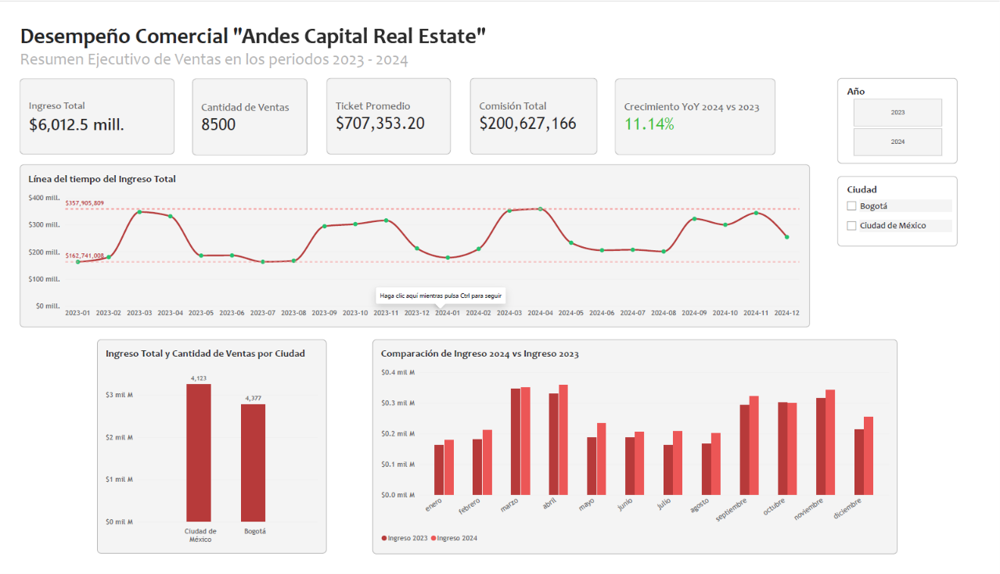
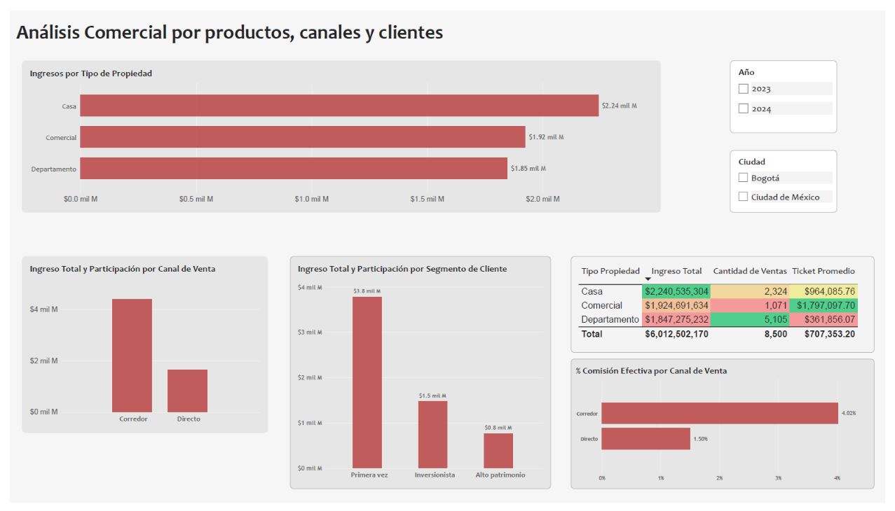
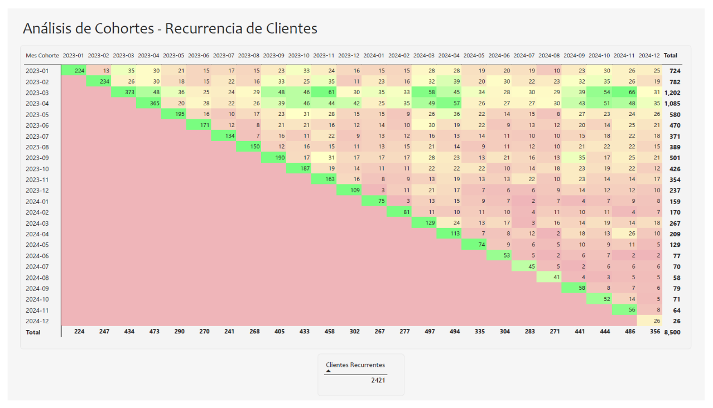

# Dashboard de desempeño comercial inmobiliario

Dashboard ejecutivo en **Power BI** para analizar el desempeño comercial de una empresa inmobiliaria: crecimiento, rentabilidad por canal, comportamiento de clientes y recompra por cohortes.

**Herramientas:** Power BI (modelo de datos y medidas DAX)

📥 **Archivo del dashboard:** [dashboard_inmobiliario.pbix](dashboard/dashboard_inmobiliario.pbix)
*(Para abrirlo se necesita Power BI Desktop.)*

---

## 1. Contexto y problema de negocio

El sector inmobiliario necesita evaluar su desempeño comercial para entender su crecimiento, su rentabilidad y el comportamiento de sus clientes. El objetivo del proyecto es construir un dashboard que apoye decisiones estratégicas con datos.

## 2. Preguntas que responde el dashboard

| Tema | Preguntas |
|------|-----------|
| Desempeño general | ¿Cuánto ingreso se generó? ¿Cuántas propiedades se vendieron? ¿Cuál es el precio promedio de venta y la comisión total? |
| Análisis comercial | ¿Qué tipo de propiedad, segmento de cliente y canal de venta generan más ingresos? |
| Análisis temporal | ¿Cómo evolucionan las ventas? ¿El negocio crece año contra año? |
| Cohortes | ¿Los clientes vuelven a comprar después de su primera compra? ¿Qué cohortes generan más ventas con el tiempo? |

## 3. Datos

| Tabla | Contenido |
|-------|-----------|
| `hecho_ventas_propiedades` | Transacciones de venta (precio, cliente, propiedad, canal, fecha, comisión) |
| `dim_clientes` | Información y segmentación de clientes |
| `dim_propiedades` | Características de las propiedades (tipo, ubicación, etc.) |
| `dim_fecha` | Tabla calendario creada para el modelo |

**Origen de los datos:** [completa aquí de dónde provienen y si se pueden publicar]

## 4. Preparación y modelado

- **Calidad de datos:** se revisaron y ajustaron los tipos de datos de las tres tablas (`fecha_venta` como fecha; `precio_venta`, `monto_comision`, `porcentaje_comision` y `precio_publicado` como número decimal). No se detectaron valores nulos ni errores, por lo que no se eliminaron registros. Tampoco hubo duplicados en las llaves primarias (`id_cliente`, `id_propiedad` e `id_venta`). Los valores repetidos en `precio_venta` son esperables, al ser un monto y no un identificador.
- **Modelo:** esquema estrella con una tabla de hechos (`hecho_ventas_propiedades`) y tres dimensiones (`dim_clientes`, `dim_propiedades`, `dim_fecha`).
- **Medidas principales:** Ingreso Total, Cantidad de Ventas, Ticket Promedio, Comisión Total, % Comisión Efectiva, Ventas Año Anterior, Crecimiento YoY, Clientes Recurrentes y medidas de participación por tipo de propiedad, canal de venta y segmento de cliente.

## 5. Estructura del dashboard

1. **Overview Ejecutivo:** KPIs principales, tendencia de ventas en el tiempo, ingresos por ciudad y crecimiento año contra año.
2. **Análisis Comercial:** ingresos por tipo de propiedad, canal de venta y segmento de cliente, con participación porcentual.
3. **Análisis de Cohortes:** matriz de cohortes (mes de la primera compra contra mes de venta) para observar la recompra.

## 6. Hallazgos clave

**Métricas principales:** Ingreso Total 6,012,502,170 · 8,500 ventas · Ticket promedio 707,353.20 · Comisión total 200,627,166.

- En 2024, los ingresos crecieron **11.14%** respecto a 2023.
- Los ingresos alcanzan sus mayores niveles entre marzo y abril y entre septiembre y noviembre; enero-febrero, mayo-agosto y diciembre presentan menor actividad, y el patrón se repite en ambos años.
- Ciudad de México lidera en ingresos gracias a su mayor ticket promedio, mientras Bogotá registra más ventas.
- El canal Corredor concentra el **72.85%** de los ingresos y tiene mayor participación que Directo entre los clientes de Primera vez.
- Los clientes de Primera vez generan el **62.93%** de los ingresos, seguidos por Inversionistas (24.47%) y Alto patrimonio (12.60%).
- Las casas lideran los ingresos con 2,240 millones (37.26%), mientras los departamentos registran la mayor cantidad de ventas (5,105). Comercial tiene el ticket promedio más alto, cercano a 1.8 millones.
- En cada cohorte, el primer mes concentra las ventas más grandes, pero la recompra continúa y se acumula: las cohortes de 2023 generaron más ventas en recompras que en su primera compra. El 77% de los clientes (2,421 de 3,139) vuelve a comprar.

## 7. Recomendaciones

1. **Portafolio:** fortalecer la venta de Casas, impulsar Comercial (pocas ventas pero cada una aporta mucho ingreso) y mantener el volumen de Departamentos.
2. **Canales:** mantener el canal Corredor y fortalecer el canal Directo (27.15% de los ingresos), cuya comisión efectiva es menor (1.50% contra 4.02% de Corredor) y puede mejorar el ingreso neto.
3. **Retención:** implementar estrategias después de la primera compra, como dar seguimiento con nuevas propiedades de interés y mantener el contacto, para aprovechar la recompra sostenida.
4. **Estacionalidad:** reforzar la comercialización en los meses de mayor demanda y diseñar estrategias para los meses bajos.

## 8. Limitaciones

- El canal Directo puede tener otros costos que no están en los datos, así que la comparación de comisiones no es un análisis de rentabilidad completo.

## 9. Autora

**Winnie Ahedo** · [LinkedIn](https://www.linkedin.com/in/winnie-ahedo/) · [winnieahedo@gmail.com]
